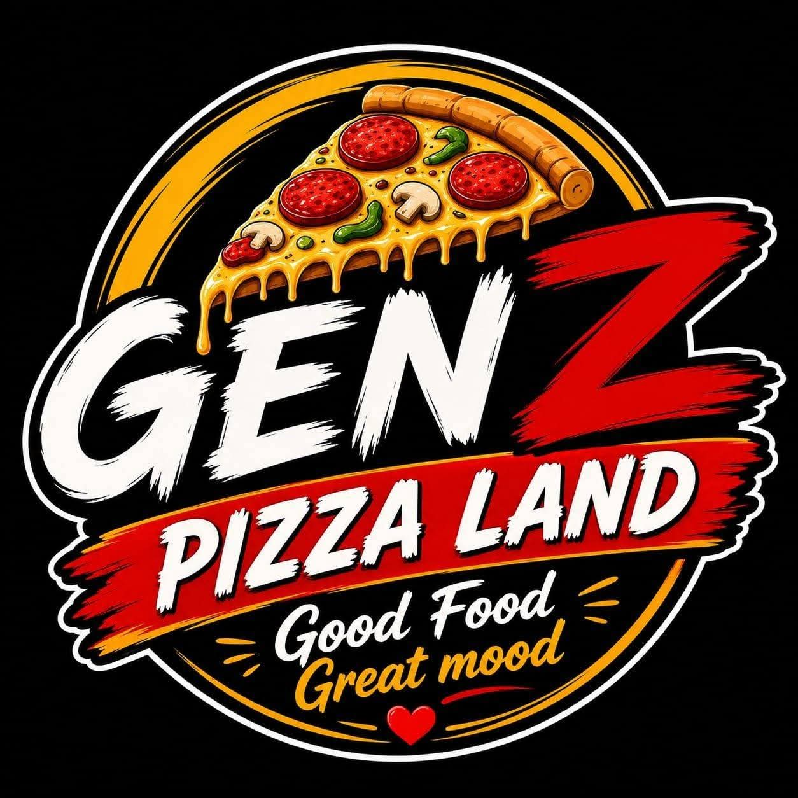

<p align="center">
  
</p>

<h1 align="center">🍕 Contributing to GenZ Pizza Land</h1>

<p align="center">Thank you for helping make the <b>GenZ Pizza Land</b> POS and online store better. 💖</p>

## 🧾 Table of Contents
- [Project Structure](#-project-structure)
- [How to Contribute](#-how-to-contribute)
- [Contribution Guidelines](#-contribution-guidelines)
- [Branding Guidelines](#-branding-guidelines)
- [Pull Request Process](#-pull-request-process)
- [Reporting Issues](#-reporting-issues)
- [License](#-license)
- [Copyright Notice](#-copyright-notice)

---

## 🗂️ Project Structure

| Folder | What it is | Port |
|---|---|---|
| `pos-backend/` | API server (Node.js, Express, MongoDB) | `3000` |
| `pos-frontend/` | POS, cashier and admin dashboard | `5173` |
| `online-store/` | Customer website (delivery and pickup) | `5174` |
| `branding/` | Official logo and favicon files | – |

---

## 🏢 How to Contribute

1. **Fork the repository** 📚
2. **Clone your fork (dev branch only)**
   ```bash
   git clone --branch dev https://github.com/awaismuj/pizza.git
   ```
3. **Go into the project folder**
   ```bash
   cd pizza
   ```
4. **Create a new branch** 🌿
   ```bash
   git checkout -b feature/your-feature-name
   ```
5. **Install dependencies in all three apps**
   ```bash
   cd pos-backend && npm install
   cd ../pos-frontend && npm install
   cd ../online-store && npm install
   cd ..
   ```
6. **Set up environment variables**
   ```bash
   cp pos-backend/.env.example pos-backend/.env
   cp pos-frontend/.env.example pos-frontend/.env
   cp online-store/.env.example online-store/.env
   ```
   Fill in your MongoDB address and JWT secret. Never commit `.env` files.
7. **Set up the database (first time only)**
   ```bash
   cd pos-backend
   npm run db:setup
   ```
8. **Run the apps** (each in its own terminal)
   ```bash
   cd pos-backend && npm run dev      # API on port 3000
   cd pos-frontend && npm run dev     # POS on port 5173
   cd online-store && npm run dev     # Store on port 5174
   ```
9. **Make your changes** ✨
10. **Test your changes**
    ```bash
    cd pos-backend && npm test         # backend tests
    cd pos-frontend && npm run lint    # POS lint
    cd pos-frontend && npm run build   # make sure it builds
    cd online-store && npm run build   # make sure it builds
    ```
11. **Commit your changes** 💾
    ```bash
    git commit -m "Add: a meaningful commit message"
    ```
12. **Push to your branch** 👤
    ```bash
    git push origin feature/your-feature-name
    ```
13. **Create a Pull Request** 🛠️

---

## 📋 Contribution Guidelines

- Follow the existing code style and naming conventions.
- Write clear, short commit messages (`Add:`, `Fix:`, `Update:`, `Remove:`).
- Keep comments short and only where the code is not obvious.
- Delivery fees, minimums and opening hours live in `pos-backend/utils/fulfillment.js`. Change the rules there, not in the screens, so the website and POS never disagree.
- Add or update a test in `pos-backend/utils/` when you change pricing or delivery rules.
- Do not commit secrets, `.env` files or `node_modules`.

---

## 🎨 Branding Guidelines

- The name is written **GenZ Pizza Land** (not "Gen Z Pizza", "GenZ Pizza" or "Restaurant POS").
- Use only the logo and icons from the `branding/` folder. Do not stretch, recolor or redraw them.
- Keep the look of the app: dark theme with the gold accent `#E8AE58` on the store, and the existing POS dashboard style.
- Customer-facing text should be short, friendly and simple.
- Keep the receipt footer and the logo on invoices and receipts.

---

## ✅ Pull Request Process

- Always branch out from the `dev` branch.
- Submit your pull request to the `dev` branch.
- Make sure the tests pass and both apps build before you open the PR.
- Link your PR to an issue if there is one.
- Wait for approval before merging.
- Only maintainers can merge into `main`.

---

## 🐛 Reporting Issues

Found a bug or have a feature request? Open an [Issue](https://github.com/awaismuj/pizza/issues) and include the steps to reproduce it and a screenshot if you can.

---

## 📝 License

This project uses the [MIT Non-Commercial License](LICENSE). You may use and modify it for non-commercial purposes only. Selling it, or putting it inside a paid product or service, is not allowed without written permission from the copyright holder.

---

## 🐝 Copyright Notice

The UI of this project is **copyrighted content**. You **cannot** copy and sell it as your own product. Unauthorized use, redistribution or resale of the UI is strictly prohibited.

The original POS UI design is on [Behance](https://www.behance.net/gallery/210280099/Restaurant-POS-System-Point-of-Sale-UIUX-Design). The GenZ Pizza Land name, logo and branding belong to GenZ Pizza Land.

Happy Coding! 💻🎉
