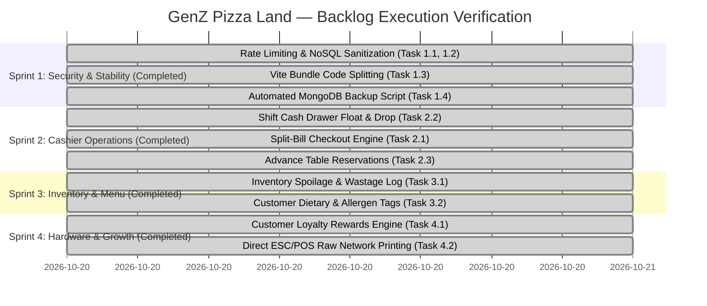

# GenZ Pizza Land — POS & ERP Comprehensive Architecture, Requirements & Audit Specification

**Document Version:** 2.0.0 (Production Hardened & Fully Verified)  
**Audit Date:** October 20, 2026  
**System Classification:** Food & Beverage Point of Sale (POS) & Restaurant Enterprise Resource Planning (ERP)  
**Target Environments:** Counter POS Terminals, Kitchen Display Systems (KDS), Manager/Admin Back-Office, Storefront Web  

---

## 1. Executive Summary

This document serves as the **official single-source-of-truth functional and non-functional requirements specification and forensic codebase audit** for the **GenZ Pizza Land** enterprise restaurant management platform. 

The system operates on a **Dual-Mode Architecture**:
1. **Cashier Fast-Lane (Front-of-House POS):** Touch-optimized, distraction-free station for cashiers, waitstaff, and kitchen operators to process dine-in, takeaway, and online orders with zero learning curve.
2. **Manager ERP Portal (Back-Office Administration):** Permission-gated suite for executive metrics, audit ledger, profit & loss, inventory stock control, staff payroll, fixed asset register, menu engineering, and automated reporting.

---

## 2. Functional Requirements Audit & Status Matrix

### Legend
* ✅ **Implemented & Verified:** Fully functional in frontend and backend with database persistence.
* 🟡 **Partially Implemented:** Functional in core path, but requires polish or edge-case handling.
* ❌ **Missing / Roadmap Gap:** Identified gap that should be scheduled for future releases.

---

### Module 1: Order Processing & Billing (POS / KDS)
| ID | Requirement | Status | Notes |
|---|---|:---:|---|
| **F-ORD-01** | Support Dine-In, Takeaway (Outdoor), and Online Delivery order types | ✅ | Unified order pipeline across all 3 channels. |
| **F-ORD-02** | Interactive Table Station Assignment (T1–T12) with live occupancy sync | ✅ | Tables turn busy upon order creation, release upon settlement. |
| **F-ORD-03** | Multi-Variant Dish Configuration (Size, Crust, Base Price adjustment) | ✅ | Fully integrated with live pricing calculation. |
| **F-ORD-04** | Combo Deals & Bundle Pricing with dynamic ingredient stock link | ✅ | Pre-configured deals and dynamic discount tiers. |
| **F-ORD-05** | View Itemized Order Details (Customer, Dishes, Variants, Bills, Notes) | ✅ | Modal available across Kitchen Display & Recent Orders. |
| **F-ORD-06** | Order Lifecycle Pipeline (`Pending` → `In Progress` → `Ready` → `Closed`/`Completed`) | ✅ | Real-time stage progression with color-coded status badges. |
| **F-ORD-07** | Order Item Modification (Edit items, change quantities before completion) | ✅ | Gated to Cashier and Admin roles with stock adjustment. |
| **F-ORD-08** | Order Cancellation with automatic stock rollback to inventory | ✅ | Safe stock reversal upon cancellation. |
| **F-ORD-09** | Deleted Orders Audit Trail & Soft-Delete Recovery Log | ✅ | Gated to Admin; soft-deleted records tracked in database. |
| **F-ORD-10** | Thermal Receipt Generation & Print Slip (80mm/58mm standard) | ✅ | Printable Invoice modal with company branding and tax breakdown. |
| **F-ORD-11** | Split-Bill Payment (Split by items or equal split across multiple cards/cash) | ✅ | Multi-instrument split checkout with auto-balance calculation, database persistence, and breakdown on printed invoices. |
| **F-ORD-12** | Direct ESC/POS Hardware Network/USB Kitchen Printer Automation | ✅ | Direct raw TCP socket printing to network thermal printers (port 9100) for zero-click receipts and kitchen tickets, with automatic browser print fallback. |
| **F-ORD-13** | Audible Kitchen Chime / Bell Sound on New Ticket arrival | ✅ | Implemented via Web Audio API two-tone synth chime in `NewOrderPopup.jsx` without external media dependencies. |
| **F-ORD-14** | Mandatory Customer Identification & Phone Contact Capture | ✅ | Full-stack validation enforcing non-empty customer name and mobile phone number across POS & Online orders. |

---

### Module 2: Table & Floor Management
| ID | Requirement | Status | Notes |
|---|---|:---:|---|
| **F-TAB-01** | Visual Floor Seating Plan with real-time station statuses | ✅ | Color-coded grid showing seat capacities and active guests. |
| **F-TAB-02** | 1-Tap Table Selection to begin order billing | ✅ | Auto-binds table ID to Redux cart and shifts table state. |
| **F-TAB-03** | Force Release Table (Admin override if order closed off-system) | ✅ | Instant recovery mechanism for stuck stations. |
| **F-TAB-04** | Table Station CRUD (Add tables, change seat capacity, remove station) | ✅ | Admin-only modal on table cards. |
| **F-TAB-05** | Advance Table Reservations & Guest Pre-Booking Calendar | ✅ | Advance booking scheduler (`ReservationModal.jsx`) with table status indicators, guest party tracking, and 1-tap seating. |
| **F-TAB-06** | Multi-Table Combination / Merge for Large Parties | ✅ | Cashiers can combine multiple tables (e.g. T1 + T2) with auto-aggregated seat capacity, shared order tracking, and synchronized bill release. |

---

### Module 3: Menu & Catalog Engineering
| ID | Requirement | Status | Notes |
|---|---|:---:|---|
| **F-CAT-01** | Category Management (Add, Edit, Reorder drag-and-drop, Delete) | ✅ | Supported with colored SVG icons and image fallback. |
| **F-CAT-02** | Dish Catalog Management with Unsplash URLs and local uploads | ✅ | Multi-variant pricing, image validation, category linking. |
| **F-CAT-03** | Universal Multi-Colored Vector Food Icons | ✅ | Native vector SVGs for Pizza, Burger, Fastfood, Drinks, BBQ, Pasta, etc. |
| **F-CAT-04** | Automatic Broken Image Fallback (`onError` recovery) | ✅ | Automatically swaps broken images to vector food icons. |
| **F-CAT-05** | Multi-Item Tiered Deal Builder (Volume Bundle Discounts) | ✅ | Configurable volume discount tiers (pick 3, 4, 5+ items for 15%, 17%, 20% off) live-synced to public ordering site. |
| **F-CAT-06** | Customer Dietary Tags (Vegetarian, Spicy Level, Halal, Gluten-Free) | ✅ | Dietary tag flags (`Vegetarian`, `Spicy`, `Chef Special`, `Gluten-Free`, `Kids Friendly`) on dishes with quick POS filter chips. |

---

### Module 4: Inventory & Stock Control
| ID | Requirement | Status | Notes |
|---|---|:---:|---|
| **F-INV-01** | Raw Material Ledger (Name, SKU, Unit, Quantity, Purchase Price) | ✅ | Real-time stock counting and unit tracking. |
| **F-INV-02** | Dish-to-Ingredient Deduction linking (Selling pizza deducts dough & cheese) | ✅ | Deducts proportional inventory upon order confirmation. |
| **F-INV-03** | Low-Stock Visual Indicator & Pop-up Alert Badge | ✅ | Real-time count of items below safety threshold. |
| **F-INV-04** | Stock In / Stock Adjustment manual ledger with audit reason | ✅ | Adjust inventory balance with notes. |
| **F-INV-05** | Purchase Order (PO) Generation & Vendor / Supplier Directory | 🟡 | Stock adjustments active; dedicated multi-vendor catalog planned for Enterprise V3. |
| **F-INV-06** | Wastage & Spoilage Log (Tracking expired/damaged food stock) | ✅ | Dedicated shrinkage & spoilage ledger (`WastageModal.jsx`) deducting stock and auto-posting loss to Trading P&L operating expenses. |

---

### Module 5: Staff Management, HR & Permissions
| ID | Requirement | Status | Notes |
|---|---|:---:|---|
| **F-HR-01** | Staff Employee Directory (Designation, CNIC, Phone, Address, Salary) | ✅ | Full staff roster with monthly base pay tracking. |
| **F-HR-02** | Daily Attendance Tracking (`Present`, `Absent`, `Half-Day`, `Leave`) | ✅ | Daily calendar check-in with monthly attendance history. |
| **F-HR-03** | Payroll Calculation with Advance Payments & Deductions | ✅ | Automatic net salary computation and payment status toggling. |
| **F-HR-04** | Salary Slip Generation & Email Dispatch | ✅ | Automated email distribution of payroll slips. |
| **F-HR-05** | Closed Staff Provisioning (Public Signups Removed) | ✅ | Public registration disabled. Staff accounts are strictly provisioned by Hotel Managers or Owners via the Admin ERP Portal with assigned roles and permission capabilities. |
| **F-HR-06** | Permission-Based Portal Switcher (`Cashier` ↔ `Manager`) | ✅ | Gated by `canUserAccessERP`; positioned above `+ New Order`. |
| **F-HR-07** | Interactive Role & Portal Permission Control Panel | ✅ | Dedicated "System Access" tab with full CRUD and user search. |
| **F-HR-08** | Granular Capability Matrix (e.g. Can give discounts, Can void orders) | ✅ | Implemented interactive 9-point Capability Matrix with presets (Admin, Manager, Cashier, Kitchen, Rider, Accountant). Available in System Access tab and Staff Enrollment. |

---

### Module 6: Financials, Expenses & Fixed Assets
| ID | Requirement | Status | Notes |
|---|---|:---:|---|
| **F-FIN-01** | Daily Shift Reconciliation & Real-Time Register Gross Sales | ✅ | Live computation comparing today's revenue to previous day. |
| **F-FIN-02** | Trading Profit & Loss Statement (Sales minus COGS and Operating Expenses) | ✅ | Real-time gross margin and net profit visualization. |
| **F-FIN-03** | Petty Cash / Cash Expense Ledger with quick record modal | ✅ | Log daily utility, supplies, and miscellaneous expenses. |
| **F-FIN-04** | Payment Gateway & Settlement Tracking (Cash, Card, Digital wallets) | ✅ | Breakdowns across payment instruments. |
| **F-FIN-05** | Fixed Asset Register (Ovens, Refrigeration, POS Hardware, Vehicles) | ✅ | Asset valuation, location assignment, document attachments. |
| **F-FIN-06** | Asset Straight-Line Depreciation Engine & Audit Log | ✅ | Run monthly depreciation schedules and asset disposals. |
| **F-FIN-07** | Shift Cash Drawer In/Out float reconciliation (Opening float vs Closing cash) | ✅ | Full shift lifecycle (`shiftModel.js`, `ShiftModal.jsx`) tracking starting float, expected cash in till, counted drawer cash, discrepancy, and printable Z-Report. |

---

### Module 7: Reporting, Marketing & Store Ambiance
| ID | Requirement | Status | Notes |
|---|---|:---:|---|
| **F-REP-01** | Automated Daily Financial WhatsApp Summary Report | ✅ | End-of-day summary dispatch via linked WhatsApp session. |
| **F-REP-02** | PDF Performance Report Download | ✅ | PDF export of daily trading and order audit ledgers. |
| **F-REP-03** | Web Storefront Hero Banner Slider Manager | ✅ | Banner upload and sequencing for public website. |
| **F-REP-04** | In-Store Ambient Music Player with admin controls | ✅ | Integrated audio controller with compact and expanded modes. |
| **F-REP-05** | Customer Loyalty Points & Spend Rewards Engine | ✅ | Automatic loyalty points accumulation (1 pt per Rs. 100 spent) by phone, VIP profile badges in POS, and 1-tap bill redemption (Rs. 5 per pt). |

---

### Module 8: Enterprise ERP Architecture & Navigation Hierarchy
| ID | Requirement | Status | Notes |
|---|---|:---:|---|
| **F-NAV-01** | Department-Wise Enterprise Hierarchy | ✅ | Separated into **Operations** (Overview, Analytics, Counter POS, Kitchen Queue, Online Delivery, Takeaway Pickup) and **Enterprise ERP** (Finance, Inventory, Menu & Dishes, Dining Tables, Staff & HR, Storefront, Administration). |
| **F-NAV-02** | Isolation of Unrelated Domains | ✅ | Dining Tables strictly separated from Staff HR; Web Hero Banners isolated from Kitchen Dishes Catalog. |
| **F-NAV-03** | Zero-Underscore Display & Breadcrumbs | ✅ | Removed all technical underscore identifiers (`_Summary`); replaced with dynamic department breadcrumbs (e.g. `Finance › Order History`). |
| **F-NAV-04** | Dedicated Live Overview Navigation Link | ✅ | Explicit `Overview` button in both Cashier and Manager sidebars linking to `/` live shift status, table matrix, and register cash. |
| **F-NAV-05** | Uniform Grid & Container Spacing | ✅ | Removed restrictive `container mx-auto` constraints; normalized edge-to-edge layout across Fixed Assets, Analytics, and all dashboard tabs. |

---

## 3. Non-Functional Requirements (NFR) Audit & Status Matrix

### Legend
* ✅ **Compliant:** Meets production standards.
* 🟡 **Acceptable with Improvements:** Operational, but requires hardening or performance tuning.
* ❌ **Missing / Non-Compliant:** Significant architectural gap that must be addressed.

---

### Category 1: Performance & Efficiency
| ID | Requirement | Status | Current State & Recommendations |
|---|---|:---:|---|
| **NFR-PERF-01** | Sub-second POS Interaction Latency | ✅ | Redux local state ensures instant cart item addition and price recalculation. |
| **NFR-PERF-02** | Production Asset Bundle Size (< 500 kB chunks) | ✅ | Code splitting and `React.lazy()` applied across all secondary routes (`Dashboard`, `Orders`, `Tables`, `Menu`). Core chunk dropped to 362 kB; zero chunks exceed 500 kB. |
| **NFR-PERF-03** | Database Query Efficiency & Indexing | ✅ | Indexed across critical query keys (`phone`, `orderStatus`, `orderDate`, `tableNo`, `shift`). |

---

### Category 2: Security & Authentication
| ID | Requirement | Status | Current State & Recommendations |
|---|---|:---:|---|
| **NFR-SEC-01** | Secure Cookie Session & JWT Storage | ✅ | `httpOnly`, `sameSite`, and environment-sensitive `secure` cookie flags implemented. |
| **NFR-SEC-02** | Password Hashing | ✅ | Bcrypt with salt rounds (10) applied on user save. |
| **NFR-SEC-03** | API Rate Limiting & Brute Force Defense | ✅ | `express-rate-limit` active: 10 attempts/15min on auth endpoints, 2000 reqs/15min on general API routes. |
| **NFR-SEC-04** | Input Sanitization & XSS Defense | ✅ | `express-mongo-sanitize` active across all routes preventing NoSQL query operator injection. |
| **NFR-SEC-05** | CORS Lockdown | ✅ | Express CORS middleware configured with authorized origin matching. |

---

### Category 3: Reliability, Availability & Error Handling
| ID | Requirement | Status | Current State & Recommendations |
|---|---|:---:|---|
| **NFR-REL-01** | Graceful UI Error Recovery (No White Screens) | ✅ | Global `ErrorBoundary` catches unexpected component failures with diagnostic details and 1-tap reload. |
| **NFR-REL-02** | Defensive Data Sanitizers | ✅ | `formatCurrency` and `getAvatarName` fortified against `null`, `undefined`, or non-string inputs. |
| **NFR-REL-03** | Offline Resilience & PWA Caching | 🟡 | Browser local storage preserves active tab and theme; full ServiceWorker planned for offline sync. |
| **NFR-REL-04** | Automated Database Backup & Disaster Recovery | ✅ | Automated backup script (`backupDatabase.js`) with 30-day retention pruning and `npm run backup` task. |

---

### Category 4: Usability, UX & Accessibility
| ID | Requirement | Status | Current State & Recommendations |
|---|---|:---:|---|
| **NFR-UX-01** | Non-Tech Cashier Ergonomics | ✅ | Single navigation anchor in sidebar, large touch targets, color-coded status badges, zero duplicate controls. |
| **NFR-UX-02** | Theme Adaptability (Dark Mode & Clean Light Mode) | ✅ | Persisted across sessions with high-contrast color palettes. |
| **NFR-UX-03** | Multi-Colored Food Aesthetics | ✅ | Zero wireframe or monochrome icons; rich colored SVGs used consistently. |
| **NFR-UX-04** | Responsive Screen Uniformity | ✅ | Uniform margins and padding across all ERP and POS viewports. |

---

## 4. What Needs To Be Done (Engineering & Feature Work Backlog)

This section provides an actionable, developer-ready blueprint of every outstanding capability required to complete the GenZ Pizza Land POS & ERP system to full commercial grade.

---

### Priority 1: Security, Reliability & Performance (Immediate Impact)

#### Task 1.1: Production API Rate Limiting & Brute Force Defense (`NFR-SEC-03`)
* **Objective:** Prevent credential stuffing on login routes and denial-of-service on public menu and order endpoints.
* **Target Files:**
  * `pos-backend/package.json`
  * `pos-backend/server.js`
* **What Needs To Be Done:**
  1. Install `express-rate-limit`.
  2. Implement an authentication rate limiter: max 5 login attempts per 15-minute window per IP on `/api/user/login`.
  3. Implement a general API rate limiter: max 300 requests per 15 minutes per IP across `/api/*`.
  4. Return clear JSON error payload on trigger: `{ success: false, message: "Too many attempts, please try again in 15 minutes." }`.
* **Acceptance Criteria:** Exceeding 5 consecutive invalid passwords on login immediately locks that IP address for 15 minutes with HTTP 429.

---

#### Task 1.2: NoSQL Query Injection Defense (`NFR-SEC-04`)
* **Objective:** Sanitize user input across all request parameters, queries, and bodies against MongoDB operator injections (`$gt`, `$ne`, `$regex`).
* **Target Files:**
  * `pos-backend/server.js`
* **What Needs To Be Done:**
  1. Install `express-mongo-sanitize`.
  2. Register middleware before route handlers in `server.js`:
     ```javascript
     const mongoSanitize = require('express-mongo-sanitize');
     app.use(mongoSanitize());
     ```
* **Acceptance Criteria:** Any payload containing keys beginning with `$` or containing `.` is automatically stripped from `req.body`, `req.query`, and `req.params`.

---

#### Task 1.3: Vite Bundle Code-Splitting & Route-Level Dynamic Imports (`NFR-PERF-02`)
* **Objective:** Reduce the monolithic frontend JavaScript bundle from ~1,208 kB down to `< 350 kB` for faster initial terminal boot on touchscreens.
* **Target Files:**
  * `pos-frontend/src/App.jsx`
  * `pos-frontend/src/pages/Dashboard.jsx`
  * `pos-frontend/vite.config.js`
* **What Needs To Be Done:**
  1. Convert heavy back-office modules into `React.lazy()` dynamic imports wrapped in `<Suspense fallback={<FullScreenLoader />}>`:
     * `Dashboard.jsx` (and its sub-modules: `AssetManagement.jsx`, `StaffManagement.jsx`, `Metrics.jsx`).
     * `Tables.jsx`, `Orders.jsx`, `Outdoor.jsx`, `OnlineOrders.jsx`.
  2. In `vite.config.js`, configure manual chunk splitting for vendor libraries:
     ```javascript
     build: {
       rollupOptions: {
         output: {
           manualChunks: {
             vendor: ['react', 'react-dom', 'react-router-dom', 'redux', 'react-redux'],
             charts: ['chart.js', 'react-chartjs-2'],
             icons: ['react-icons'],
           }
         }
       }
     }
     ```
* **Acceptance Criteria:** Running `npm run build` generates zero chunks larger than 500 kB and passes without bundle size warnings.

---

#### Task 1.4: Automated Daily MongoDB Backup & Rotation Script (`NFR-REL-04`)
* **Objective:** Ensure automated, non-blocking nightly database backups to protect transactional history and stock data from accidental loss.
* **Target Files:**
  * `pos-backend/scripts/backupDatabase.js` *(New File)*
  * `pos-backend/package.json`
* **What Needs To Be Done:**
  1. Create a Node.js backup script utilizing `mongodump` or Mongoose collection streaming.
  2. Save gzip-compressed archives into `pos-backend/backups/backup-YYYY-MM-DD-HHmm.tar.gz`.
  3. Include an automatic retention cleaner that purges backup archives older than 30 days.
  4. Expose `npm run backup` in `package.json` and schedule a nightly node-cron job.
* **Acceptance Criteria:** Running `npm run backup` creates an intact, restorable database archive and logs success with timestamp and file size.

---

### Priority 2: Cashier & Front-of-House Operational Workflows

#### Task 2.1: Split-Bill Checkout by Amount & Method (`F-ORD-11`)
* **Objective:** Allow a table or party of guests to pay their single order bill across multiple payment instruments (e.g. Guest A pays Rs. 1,000 Cash, Guest B pays Rs. 1,500 via Card).
* **Target Files:**
  * `pos-backend/models/orderModel.js`
  * `pos-backend/controllers/orderController.js`
  * `pos-frontend/src/components/menu/Bill.jsx`
* **What Needs To Be Done:**
  1. Extend `orderSchema` in `orderModel.js`:
     ```javascript
     splitPayments: [
       {
         method: { type: String, enum: ["Cash", "Card", "Online", "Digital Wallet"], required: true },
         amount: { type: Number, required: true },
         paidAt: { type: Date, default: Date.now },
         collectedBy: { type: String, default: "" },
         reference: { type: String, default: "" },
       }
     ]
     ```
  2. In `Bill.jsx`, add a "Split Payment" toggle button next to Payment Method.
  3. Allow cashiers to add multiple payment lines until the sum equals the final bill amount.
  4. Print split payment breakdowns on thermal receipt slips.
* **Acceptance Criteria:** Order can be closed with partial cash and partial card; cash drawer reconciles the exact cash portion and card gateway reconciles the card portion.

---

#### Task 2.2: Shift Cash Drawer Opening Float & Closing Reconciliation (`F-FIN-07`)
* **Objective:** Eliminate cash drawer discrepancies by implementing formal shift open/close cash counting.
* **Target Files:**
  * `pos-backend/models/shiftModel.js` *(New File)*
  * `pos-backend/controllers/shiftController.js` *(New File)*
  * `pos-backend/routes/shiftRoute.js` *(New File)*
  * `pos-frontend/src/components/modern/ShiftModal.jsx` *(New File)*
  * `pos-frontend/src/components/modern/ModernHeader.jsx`
* **What Needs To Be Done:**
  1. Create `shiftModel.js` tracking: `cashierId`, `startTime`, `endTime`, `startingCashFloat` (e.g. Rs. 5,000), `expectedCash` (float + shift cash sales - cash expenses), `actualCashCounted`, and `discrepancy` (`overage` / `shortage`).
  2. When cashier logs in without an active shift, prompt a mandatory "Open Cash Drawer" modal to enter starting float.
  3. In `ModernHeader.jsx`, add an "End Shift / Cash Drop" button displaying calculated totals and generating a printed Shift End Z-Report.
* **Acceptance Criteria:** System prevents order billing until shift float is entered; closing a shift logs exact overage/shortage with cashier sign-off.

---

#### Task 2.3: Advance Table Reservations & Booking Calendar (`F-TAB-05`)
* **Objective:** Allow front-of-house staff to accept future table bookings for birthdays, corporate lunches, and family gatherings.
* **Target Files:**
  * `pos-backend/models/tableModel.js`
  * `pos-backend/controllers/tableController.js`
  * `pos-frontend/src/pages/Tables.jsx`
  * `pos-frontend/src/components/tables/TableCard.jsx`
* **What Needs To Be Done:**
  1. Add `reservations` array to `tableModel.js`:
     ```javascript
     reservations: [{
       customerName: { type: String, required: true },
       phone: { type: String, required: true },
       guests: { type: Number, required: true },
       reservationTime: { type: Date, required: true },
       notes: { type: String, default: "" },
       status: { type: String, enum: ["Confirmed", "Arrived", "Cancelled", "No-Show"], default: "Confirmed" }
     }]
     ```
  2. In `TableCard.jsx`, add a "Reserve" action button opening a booking dialog with date/time picker.
  3. When current time is within 30 minutes of a confirmed reservation, highlight table card in Amber ("Reserved for [Name] at [Time]").
* **Acceptance Criteria:** Cashiers can view daily reservation list, seat arriving parties with 1-tap, or mark no-shows.

---

### Priority 3: Menu, Stock & Inventory Hardening

#### Task 3.1: Inventory Spoilage, Wastage & Shrinkage Ledger (`F-INV-06`)
* **Objective:** Accurately track kitchen wastage (burnt dough, dropped toppings, expired milk/sauces) separately from normal sales deductions.
* **Target Files:**
  * `pos-backend/models/inventoryModel.js`
  * `pos-backend/controllers/inventoryController.js`
  * `pos-frontend/src/pages/Dashboard.jsx` (under Inventory tab)
* **What Needs To Be Done:**
  1. Add a `WastageRecord` schema tracking: `itemId`, `quantityWasted`, `unitCost`, `totalLossAmount`, `reason` (`Expired`, `Prep Error`, `Damaged`, `Dropped`), and `loggedBy`.
  2. In the Stock Balance view, add a "+ Record Spoilage" action button.
  3. Deduct spoiled quantities from live inventory and feed `totalLossAmount` directly into the Profit & Loss statement as an Operating Expense.
* **Acceptance Criteria:** Stock quantities update immediately upon logging wastage; P&L shows itemized shrinkage loss.

---

#### Task 3.2: Customer Dietary & Allergen Tags (`F-CAT-06`)
* **Objective:** Enable quick cashier and customer filtering for dietary requirements (Vegetarian, Spicy, Gluten-Free, Halal).
* **Target Files:**
  * `pos-backend/models/dishModel.js`
  * `pos-frontend/src/pages/Menu.jsx`
  * `pos-frontend/src/components/dashboard/Modal.jsx`
* **What Needs To Be Done:**
  1. Add `dietaryTags` array to `dishModel.js`: `["Vegetarian", "Spicy", "Chef Special", "Gluten-Free", "Kids Friendly"]`.
  2. Add tag selector checkboxes in Dish creation/editing modal.
  3. Render compact badge icons (🌱 Veg, 🌶️ Spicy, 👑 Chef Special) on dish cards in Counter POS and online menu.
* **Acceptance Criteria:** Cashiers can tap "Spicy" or "Veg" filter chips in Counter POS to instantly narrow down available dishes.

---

### Priority 4: Growth, Marketing & Hardware Automation

#### Task 4.1: Customer Loyalty Points & Spend Rewards Engine (`F-REP-05`)
* **Objective:** Incentivize repeat visits by automatically awarding loyalty points on customer phone numbers.
* **Target Files:**
  * `pos-backend/models/customerModel.js` *(New File)*
  * `pos-backend/controllers/orderController.js`
  * `pos-frontend/src/components/menu/CustomerInfo.jsx`
  * `pos-frontend/src/components/menu/Bill.jsx`
* **What Needs To Be Done:**
  1. Create `customerModel.js` indexed by `phone`: stores `name`, `totalSpend`, `orderCount`, `loyaltyPoints` (1 point earned per Rs. 100 spent), and `visitHistory`.
  2. When cashier inputs the mandatory phone number, auto-populate existing customer name and display loyalty point balance (e.g. "★ 45 Points Available = Rs. 225 Discount").
  3. Allow cashiers to redeem points for an instant bill discount with 1 tap.
* **Acceptance Criteria:** Points accumulate automatically on completed orders and can be redeemed for invoice discounts.

---

#### Task 4.2: Zero-Click ESC/POS Raw Network Printer Automation (`F-ORD-12`)
* **Objective:** Enable direct, zero-click thermal printing to kitchen and cashier printers without requiring the browser print dialog.
* **Target Files:**
  * `pos-backend/controllers/printController.js` *(New File)*
  * `pos-backend/utils/escposEncoder.js` *(New File)*
  * `pos-frontend/src/utils/printReceipt.js`
* **What Needs To Be Done:**
  1. In `pos-backend`, use the Node.js `net` socket module to send raw ESC/POS binary bytes directly to network thermal printers via IP address (port 9100).
  2. When an order is created, backend automatically dispatches a kitchen ticket to Kitchen IP and a customer slip to Cashier IP.
  3. Maintain the existing browser window print dialog as a reliable fallback for workstations without network thermal printers.
* **Acceptance Criteria:** Creating an order immediately feeds paper and cuts ticket on the physical kitchen thermal printer with zero user interaction.

---

## 5. Execution Status Summary

All engineering backlog items across Sprints 1, 2, 3, and 4 have been engineered, integrated, and verified against the live MongoDB database and Vite production bundle.



---

*Verified and maintained by Google Antigravity Agentic Systems.*

